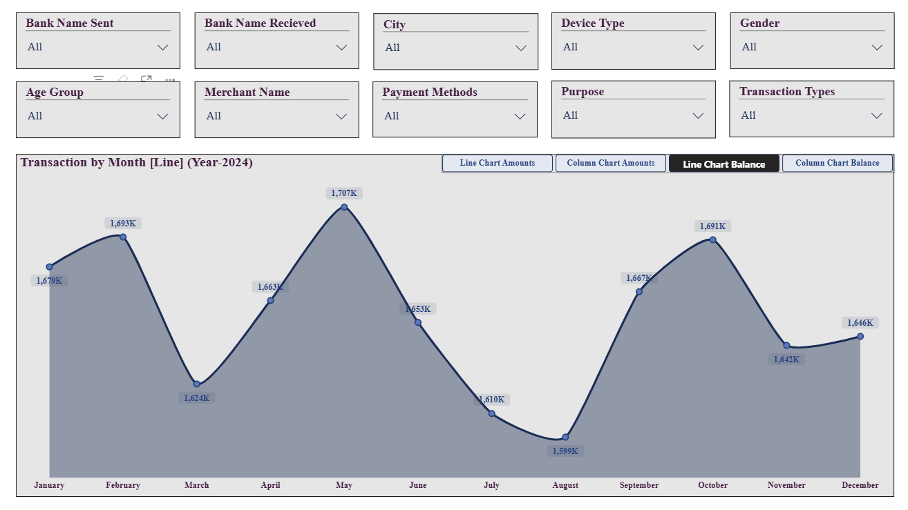
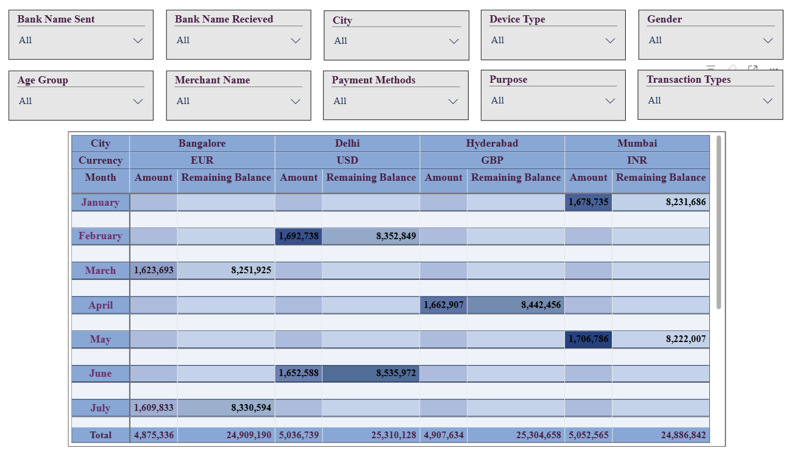

#  💳 UPI Transaction Analysis Dashboard | SQL Server & Power BI

An end-to-end data analytics project focused on analyzing UPI transaction patterns, transaction amounts, remaining balances, payment methods, and user behavior. The project uses SQL Server for data exploration and validation, with Power BI for interactive reporting and visualization of transaction trends across banks, cities, merchants, devices, and customer demographics.

---

## Table of Contents

- [About the Project](#about-the-project)
- [Technologies Used](#technologies-used)
- [Dataset](#dataset)
- [Project Objectives](#project-objectives)
- [Project Workflow](#project-workflow)
- [SQL Analysis](#sql-analysis)
- [Power BI Dashboard](#power-bi-dashboard)
- [Key Findings](#key-findings)
- [Business Recommendations](#business-recommendations)
- [How to Run](#how-to-run)
- [Project Structure](#project-structure)
- [Future Improvements](#future-improvements)
- [Author](#author)

---

## About the Project

The objective of this project is to analyze UPI transaction data and develop an interactive Power BI dashboard that helps users explore transaction trends, payment behavior, and remaining balances across different dimensions.

The dashboard includes transaction amount and remaining balance trends over time, along with interactive filters for sender and receiver banks, cities, device types, gender, age groups, merchants, payment methods, transaction purposes, and transaction types.

These analytical views help users investigate transaction patterns, compare activity across different categories, and explore how transaction metrics vary with the selected filters.

This project demonstrates practical skills in data analysis, SQL-based data exploration, business intelligence reporting, interactive visualization, and transaction behavior analysis.

---

## Technologies Used

- **SQL Server** — database management and data exploration, where applicable to the project workflow.
- **SQL Server Management Studio (SSMS)** — executing SQL queries and inspecting database tables.
- **Microsoft Power BI Desktop** — interactive dashboard development and data visualization.
- **Power Query** — data import and transformation, where implemented.
- **DAX (Data Analysis Expressions)** — measures and calculated metrics, where implemented.
- **Excel or CSV** — source data storage and inspection, depending on the original dataset format.

---

## Dataset

The project uses a UPI transaction dataset containing transaction details, banking information, user demographics, payment information, and remaining balance values.

The Power BI report references a table named `UPI Transactions`.

### Key Columns

| Column | Description |
|---|---|
| `TransactionDate` | Date associated with the transaction. |
| `Amount` | Transaction amount. |
| `RemainingBalance` | Remaining balance recorded for the transaction. |
| `BankNameSent` | Sender bank associated with the transaction. |
| `BankNameReceived` | Receiver bank associated with the transaction. |
| `City` | City associated with the transaction record. |
| `DeviceType` | Device category used for the transaction. |
| `Gender` | Gender category available in the dataset. |
| `Age Groups` | Age-group classification used for demographic analysis. |
| `MerchantName` | Merchant associated with the transaction. |
| `PaymentMethod` | Payment method recorded in the dataset. |
| `Purpose` | Recorded purpose of the transaction. |
| `TransactionType` | Transaction type used for categorization. |
| `Currency` | Currency associated with the transaction record. |

**Data note:** These field names are based on the uploaded Power BI report. The dataset's source, row count, date range, currency conventions, and data-quality characteristics should be verified before being documented.

---

## Project Objectives

- Explore UPI transaction data and understand its structure.
- Analyze transaction amounts across different dates and categories.
- Examine changes in transaction activity over time.
- Analyze remaining balance trends.
- Compare transaction patterns across sender and receiver banks.
- Investigate transaction activity by city, merchant, and device type.
- Explore payment methods, transaction types, and transaction purposes.
- Analyze transaction patterns across available demographic groups.
- Build an interactive Power BI dashboard to support data-driven analysis.

---

## Project Workflow

1. **Data Import:** Load the UPI transaction dataset into the analysis workflow.
2. **Data Exploration:** Inspect the available columns, transaction dates, amounts, and categorical fields.
3. **Data Validation:** Verify record counts, missing values, duplicates, and relevant data types, where these checks are implemented.
4. **Data Preparation:** Prepare the data for analysis using the applicable SQL or Power Query operations.
5. **Transaction Analysis:** Examine transaction amount trends over time.
6. **Balance Analysis:** Visualize remaining balance trends across transaction dates.
7. **Interactive Filtering:** Add slicers for banks, cities, devices, demographics, merchants, payment methods, purposes, and transaction types.
8. **Visualization:** Present the analysis through Power BI charts and a tabular view.
9. **Business Interpretation:** Use the dashboard to investigate patterns and identify questions for further analysis.

---

## SQL Analysis

SQL can be used to explore and validate the UPI transaction dataset before creating the Power BI report.

The following are relevant SQL analysis tasks for this project. They should be included as completed project work only if they are present in your actual SQL scripts.

### 1. Inspect Transaction Records

```sql
SELECT *
FROM [dbo].[UPI Transactions];
```

Retrieves the transaction records for initial inspection. Adjust the database, schema, and table name to match your actual SQL Server setup.

### 2. Count Total Records

```sql
SELECT COUNT(*) AS [Total Transactions]
FROM [dbo].[UPI Transactions];
```

Counts the rows in the transaction table. This represents the number of transaction records, not necessarily the number of unique transactions unless transaction identifiers have been validated.

### SQL Analysis Areas

- Database and table exploration.
- Record counts and data validation.
- Checking missing values and duplicate records.
- Inspecting transaction amounts and date fields.
- Grouping transactions by payment method, city, bank, or transaction type.
- Aggregating transaction amounts over time.
- Preparing data for Power BI reporting.

**Note:** The SQL queries above are illustrative examples based on the dashboard's data model. Replace the table reference with your actual SQL table name, and include only the SQL operations you have performed.

---

## Power BI Dashboard

The Power BI report contains two pages with transaction trend visualizations, a tabular view, and interactive slicers.

### 1. Transaction Analysis Dashboard — Page 1

The first page contains transaction amount and remaining balance visualizations over time, together with filters for exploring transaction categories and user characteristics.

**Analytical focus:**

- Examine transaction amount trends by transaction date.
- Analyze remaining balance trends over time.
- Filter results by sender and receiver banks.
- Explore transaction patterns across cities and device types.
- Compare activity across age groups and gender categories.
- Investigate merchants, payment methods, purposes, and transaction types.

### 2. Transaction Details and Filtering — Page 2

The second page includes an interactive table with transaction-level fields and slicers for filtering the displayed records.

**Analytical focus:**

- Inspect transaction dates and amounts.
- Explore remaining balance values.
- Review transaction records by city and currency.
- Filter transactions using banking, demographic, merchant, and payment-related fields.
- Investigate individual records within the selected filters.

### Dashboard Screenshots

Create a `screenshots/` folder in your GitHub repository and add screenshots captured from the actual Power BI report.

#### Transaction Analysis Dashboard



#### Transaction Details and Filtering



**Note:** These image paths are placeholders. Add the actual screenshots using these filenames or update the Markdown references to match your uploaded images.

---

## Key Findings

The dashboard supports investigation of the following questions:

- How do transaction amounts change over time?
- How does the recorded remaining balance vary across transaction dates?
- How do transaction patterns differ across sender and receiver banks?
- Which cities and merchants account for the largest transaction amounts?
- How do payment methods and transaction types differ in transaction activity?
- How does transaction activity vary across device types and demographic groups?
- What patterns can be observed when filtering by transaction purpose?

Actual findings should be added after examining the report results. For example, identify the highest-activity period or leading payment category only after verifying the relevant values.

---

## Business Recommendations

The dashboard can support the following potential business actions, depending on the verified results:

- **Transaction monitoring:** Track changes in transaction amounts over time to identify unusual patterns for further investigation.
- **Banking analysis:** Compare transaction activity across sender and receiver banks to understand differences in transaction distribution.
- **Payment behavior:** Examine payment methods and transaction types to understand how users interact with available payment options.
- **Merchant analysis:** Identify merchants with high transaction activity and investigate their contribution to overall transaction value.
- **Geographic analysis:** Compare activity across cities to understand geographic differences in transaction behavior.
- **User behavior analysis:** Explore demographic and device-related patterns to support a better understanding of transaction preferences.
- **Balance monitoring:** Investigate changes in recorded remaining balances alongside transaction amounts, while accounting for the dataset's balance definitions and limitations.

These are potential recommendations rather than confirmed outcomes. Transaction amounts and remaining balances alone do not establish fraud, financial risk, or user preferences without additional evidence.

---

## How to Run

### 1. Clone the Repository

```bash
git clone YOUR_GITHUB_REPOSITORY_URL
```

Alternatively, download the repository as a ZIP file from GitHub and extract it.

### 2. Set Up the Dataset

Locate the original UPI transaction dataset in the repository.

If the dataset is stored in CSV or Excel format, verify that the file is available and that its column names match the fields referenced in the Power BI report.

### 3. Set Up SQL Server (If Applicable)

Open SQL Server Management Studio and connect to your SQL Server instance.

Import the dataset into the database and table referenced by your SQL scripts. Execute the SQL queries in the appropriate order.

If the project uses a different source database or a direct file connection, follow the actual connection method instead.

### 4. Open the Power BI Report

Open the project's `.pbix` file using Microsoft Power BI Desktop.

If prompted to reconnect to the source dataset, update the data source path or database connection settings.

### 5. Refresh and Explore the Dashboard

Refresh the report if necessary. Navigate between the two report pages and use the slicers to explore transaction amounts, remaining balances, and transaction categories.

Verify that the charts and table update correctly when filters are applied.

### 6. Add Screenshots to GitHub

1. Open the report in Power BI Desktop.
2. Navigate to each report page.
3. Capture a clear screenshot of the dashboard.
4. Save the screenshots in the `screenshots/` folder.
5. Update the image references in this README if necessary.
6. Commit and push the README and screenshots to GitHub.

---

## Project Structure

```text
UPI-Transaction-Analysis-Dashboard-/
│
├── README.md
├── Project 3.pbix
│
├── data/
│   └── UPI_Transactions.csv
│
├── sql/
│   └── UPI_Transaction_Analysis.sql
│
└── screenshots/
    ├── upi-transaction-analysis.png
    └── upi-transaction-details.png
```

**Note:** This is a suggested repository structure. The dataset and SQL script filenames are examples; retain the actual filenames used in your repository. If your project does not contain a separate SQL script or source dataset, remove those entries.

---

## Future Improvements

- Add verified KPIs such as total transaction amount, transaction count, and average transaction amount.
- Add period-over-period comparisons for transaction activity.
- Document the SQL queries and data preparation steps.
- Include data-quality checks for missing values, duplicates, and invalid transaction amounts.
- Add more detailed comparisons by bank, city, merchant, and payment method.
- Document the definitions and limitations of the remaining balance field.
- Add verified numerical findings and business insights to the README.
- Improve dashboard navigation and provide additional drill-through analysis where appropriate.

---

## Author

**Aakanksha Haravde**

Aspiring Data Analyst | SQL | Power BI | Excel | Data Analytics | Business Intelligence
